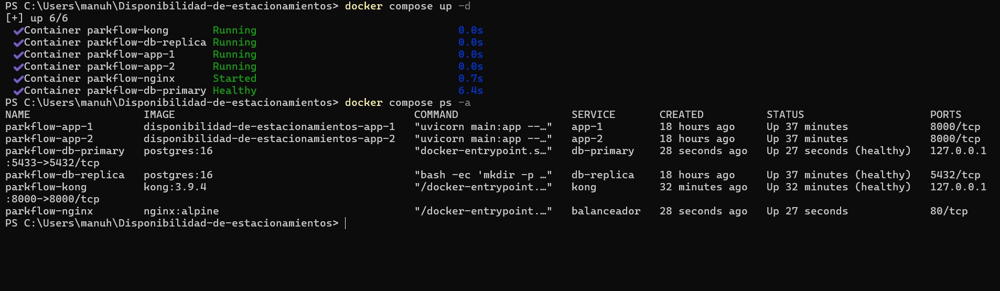
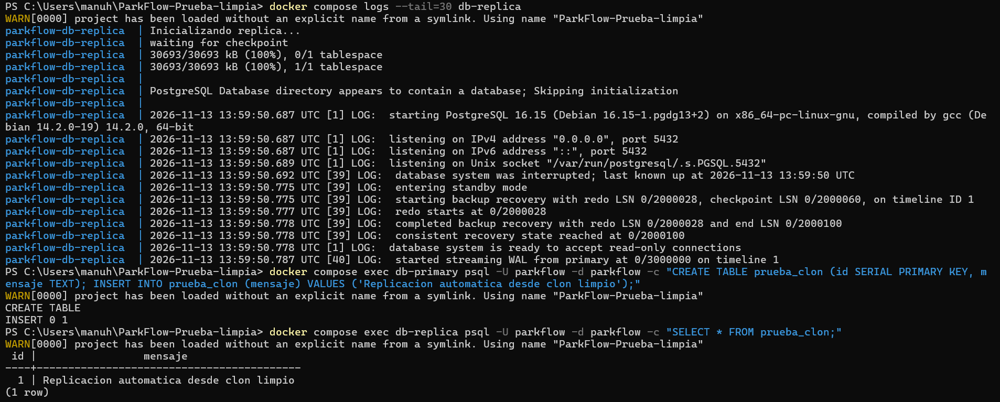
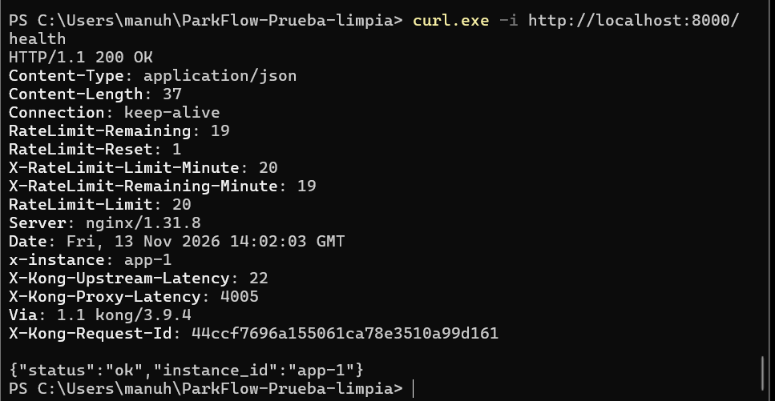

# Fase 2 — Evidencias de funcionamiento
**Proyecto:** ParkFlow
**Asignatura:** ISI601 — Taller de Diseño de SistemaS
**Fecha:** 13 de noviembre de 2026

## Arquitectura completa en Docker

Se levantó la arquitectura mediante `docker compose up -d`, verificando el funcionamiento de los seis contenedores: Kong, NGINX, dos instancias FastAPI, PostgreSQL primaria y PostgreSQL réplica.



## 1. API Gateway — Kong

Se configuró Kong 3.9.4 como punto de entrada de la arquitectura, enviando las solicitudes a NGINX.

**Comando ejecutado:**

`curl.exe -i http://localhost:8000/health`

**Resultado:** HTTP 200 OK. La respuesta incluye `Via: 1.1 kong/3.9.4` y `X-Instance: app-1`, demostrando que la solicitud pasó por Kong y fue atendida por FastAPI.

## 2. Balanceador de carga — NGINX

Se realizaron 10 solicitudes a través de Kong.

**Resultado:**
- 5 solicitudes atendidas por `app-1`.
- 5 solicitudes atendidas por `app-2`.
- Todas respondieron HTTP 200.
- Todas incluyeron la cabecera `Via: 1.1 kong/3.9.4`.


## 3. Protección del API Gateway

Se configuró el plugin Rate Limiting de Kong con un límite de 20 solicitudes por minuto por IP.

**Prueba:** envío de 25 solicitudes consecutivas.

**Resultado:**
- 20 solicitudes respondieron HTTP 200.
- 5 solicitudes fueron rechazadas con HTTP 429.

Esto demuestra que Kong aplica correctamente el límite configurado.


## 4. PostgreSQL — Primaria y réplica

Se utilizó PostgreSQL 16 con replicación por streaming.

**Comprobación de roles:**
- Primaria: `pg_is_in_recovery()` devolvió `f`.
- Réplica: `pg_is_in_recovery()` devolvió `t`.


**Prueba de replicación:**

Se insertó en la primaria el registro ID `2` con el mensaje `Evidencia Fase 2 - 13 noviembre`.

Posteriormente, al consultar la réplica, se obtuvo el mismo registro, comprobando que la replicación de datos funciona.


## 5. Conclusión

Se verificó el funcionamiento de Kong API Gateway, el balanceo de carga mediante NGINX, las dos instancias FastAPI, el límite de solicitudes y la replicación de PostgreSQL.


## 6. Prueba de instalación desde un clon limpio

El 13 de noviembre de 2026 se clonó el repositorio en una carpeta independiente llamada `ParkFlow-Prueba-limpia`.

Se creó el archivo `.env` desde `.env.example` y se ejecutó:

```powershell
docker compose up -d
```

Docker Compose creó seis contenedores y dos volúmenes nuevos de PostgreSQL.

### 6.1. Replicación automática

Se comprobó que la réplica se inicializó sin configurar manualmente sus credenciales ni permisos.

Los registros mostraron:

```text
database system is ready to accept read-only connections
started streaming WAL from primary
```

También se creó una tabla y se insertó un registro en la primaria. La consulta posterior en la réplica devolvió el mismo registro.



### 6.2. Funcionamiento de Kong

Se ejecutó:

```powershell
curl.exe -i http://localhost:8000/health
```

La respuesta incluyó:

```text
HTTP/1.1 200 OK
x-instance: app-1
Via: 1.1 kong/3.9.4
```

Esto demuestra que Kong, NGINX y FastAPI también funcionan desde el clon limpio.



### 6.3. Resultado

Se verificó que la arquitectura puede inicializarse desde un clon limpio con `docker compose up -d`, una vez configurado el archivo `.env`.
