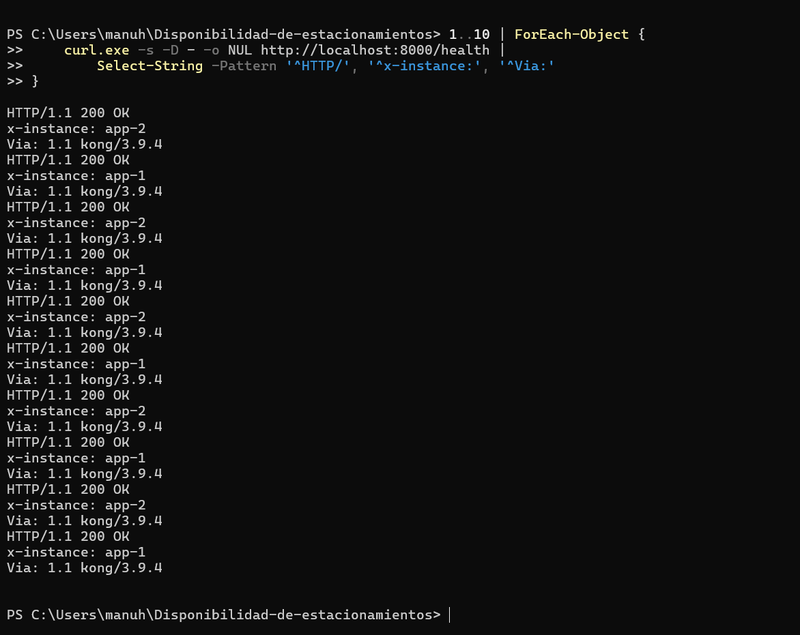
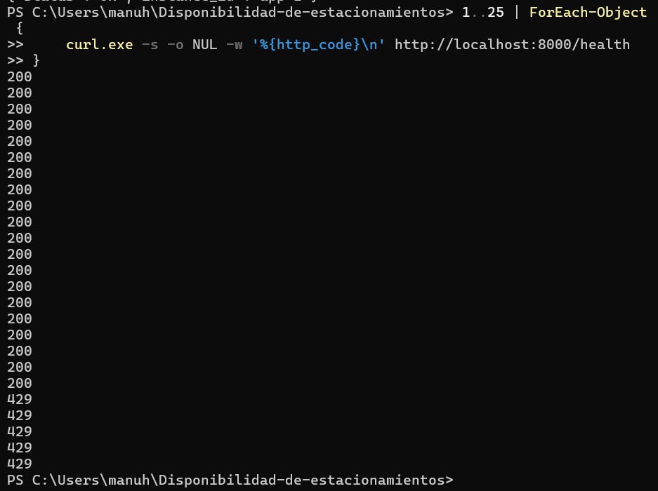
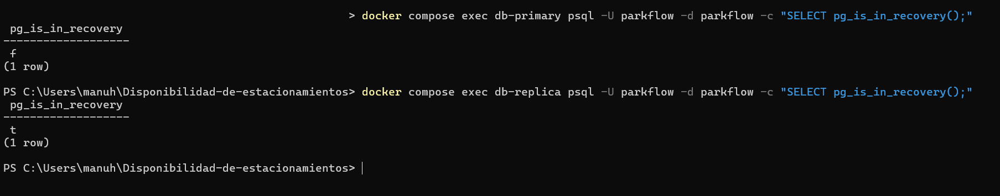
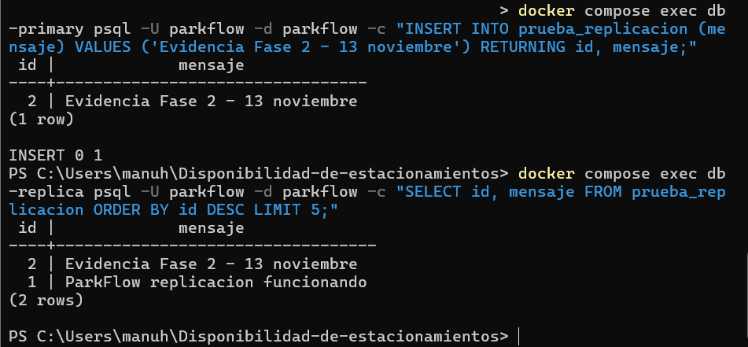

# Fase 2 — Evidencias de funcionamiento
**Proyecto:** ParkFlow
**Asignatura:** ISI601 — Taller de Diseño de SistemaS
**Fecha:** 13 de noviembre de 2026
## 1. API Gateway — Kong

Se configuró Kong 3.9.4 como punto de entrada de la arquitectura, enviando las solicitudes a NGINX.

**Comando ejecutado:**

`curl.exe -i http://localhost:8000/health`

**Resultado:** HTTP 200 OK. La respuesta incluye `Via: 1.1 kong/3.9.4` y `X-Instance: app-1`, demostrando que la solicitud pasó por Kong y fue atendida por FastAPI.

## 2. Balanceador de carga — NGINX

Se realizaron 10 solicitudes a través de Kong.

**Resultado:**
- 5 solicitudes atendidas por `app-1`.
- 5 solicitudes atendidas por `app-2`.
- Todas respondieron HTTP 200.
- Todas incluyeron la cabecera `Via: 1.1 kong/3.9.4`.

## 3. Protección del API Gateway

Se configuró el plugin Rate Limiting de Kong con un límite de 20 solicitudes por minuto por IP.

**Prueba:** envío de 25 solicitudes consecutivas.

**Resultado:**
- 20 solicitudes respondieron HTTP 200.
- 5 solicitudes fueron rechazadas con HTTP 429.

Esto demuestra que Kong aplica correctamente el límite configurado.

## 4. PostgreSQL — Primaria y réplica

Se utilizó PostgreSQL 16 con replicación por streaming.

**Comprobación de roles:**
- Primaria: `pg_is_in_recovery()` devolvió `f`.
- Réplica: `pg_is_in_recovery()` devolvió `t`.

**Prueba de replicación:**

Se insertó en la primaria el registro ID `2` con el mensaje `Evidencia Fase 2 - 13 noviembre`.

Posteriormente, al consultar la réplica, se obtuvo el mismo registro, comprobando que la replicación de datos funciona.

## 5. Conclusión

Se verificó el funcionamiento de Kong API Gateway, el balanceo de carga mediante NGINX, las dos instancias FastAPI, el límite de solicitudes y la replicación de PostgreSQL.

**Pendiente de validar:** levantamiento reproducible de toda la arquitectura desde un clon limpio del repositorio.