# ParkFlow — Pruebas de fallos (Fase 3)

## Prueba 1 — Caída de una instancia FastAPI

**Fecha:** 19 de noviembre de 2026.

**Objetivo:** Comprobar que el sistema continúa respondiendo cuando una instancia FastAPI deja de funcionar.

**Procedimiento:**
1. Se verificó que los seis contenedores estaban funcionando.
2. Se detuvo `app-2` mediante `docker compose stop app-2`.
3. Se consultó `/health` a través de Kong.
4. Se consultó `/api/v1/estacionamientos`.
5. Se restauró la instancia con `docker compose start app-2`.

**Resultados:**
- GET /health: HTTP 200 OK.
- GET /api/v1/estacionamientos: HTTP 200 OK.
- X-Instance: app-1.
- X-DB: replica.
- Latencia upstream observada en la consulta: 2573 ms.
- No se midió el tiempo total de recuperación.

**Captura 1 "falla1_app2_detenida"** Se observa que app-2 (instancia 2) presenta estado Exited (0), mientras que app-1, Kong, NGINX y ambas bases de datos permanecen funcionando
**Captura 2 "falla1_disponibilidad_app1"**La solicitud de disponibilidad devuelve HTTP 200 OK mediante la instancia app-1 (X-Instance: app-1), consultando postgreSQL replica. Se confirma que el sistema continúa atendiendo solicitudes con una sola instancia operativa

**Conclusión:** Al dethener app-2, NGINX continuó atendiendo solicitudes mediante app-1. La aplicación mantuvo las consultas de disponibilidad desde PostgreSQL réplica.

## Prueba 2 — Fallo de comunicación con la réplica

**Fecha:** 19 de noviembre de 2026.

**Objetivo:** Evaluar el comportamiento de ParkFlow cuando la réplica deja de aplicar actualizaciones y cuando pierde completamente la comunicación con la aplicación.
**Experimento A - Lecturas desactualizadas**
**Procedimientos**
1. Se oausó la reproducción de WAL en postgreSQL réplica:
SELECT pg_wal_replay_pause()
2. Se verificó el estado mediante:
SELECT pg_is_wal_replay_paused()
3. El resultado fue t (true), confirmando la pausa.
4. Se registró una entrada del vehículo TEST22 en el espacio 2 mediante un POST hacia la primaria.
5. Se consultó la disponiblidad desde la API y directamente desde ambas bases de datos.

**Resultados**
La operación POST devolvió HTTP 201 Created con la cabecera X-DB: primary
Se observo la siguiente diferencia:
Base de datos       | Libres  | Ocupados
PostgreSQL Primaria |  199    |     1
PostgreSQL Réplica  |  200    |     0

La aplicación continuó leyendo desde la réplica, por lo que mostró información desactualizada
**Captura 1: "falla2_DBreplica_Pausada"** Se verificó que la replíca dejo de aplicar las actualizaciones recibidas

**Captura 2: "falla2_escritura_DBprimaria"** Se registro la entrada del vehiculo TEST22 con HTTP 201 Created y X-DB: Primary

**Captura 3: "falla2_lectura_desactualizada"**La primaria mostraba 199 espacios libres mientras que la réplica seguía mostrando 200

**Recuperación de la replicación**
Se reanudó la reproducción WAL mediante:
SELECT pg_wal_Replay_resume()
Posteriormente, la consulta a través de ParkFlow volvió a mostrar 199 espacios libres y 1 ocupado con HTTP 200 OK  y X-DB:Replica

**Captura 4: "falla2_DBreplica_recuperada"** La replica volvió a mostrar los datos actualizados

**Experimento B - Perdida de cominicación con la replica**

**Procedimiento**
1. Se identifcó la red Docker disponibilidad-de-estacionamientos_default
2. Se desconectó mediante:
docker network disconnect disponibilidad-de-estacionamientos_default parkflow-db-replica
3. Se realizó una solicitud GET a /api/v1/estacionamientos.
4. Se reconectó la replica mediante:
docker network connect --alias db-replica disponibilidad-de-estacionamientos_default parflow-db-replica
5. Se repitió la consulta para comprobrar la recuperación

**Resultados**
Comprobación                 |  Resultado

GET durante la conexión      |   HTTP 500 Internal Server Erro
GET despúes de reconectar    |    HTTP 200 OK
Base consulta tras recuperar |    replica
Disponilidad recuperada      |     199 libres, 1 ocupado

**Captura 1: falla2_replica_desconectada** la API devolvió HTTP 500 Internal server cuando perdío la conexion con la replica 

**Captura 2: falla2_conexión_recuperada** La API volvió a responder HTTP 200 OK y X-DB: replica mostrando la disponibilidad actualizada.

**Conclusión de la prueba 2**

Se comprobaron dos comportamientos diferentes:

**Retraso en la replicación** La aplicación continuó funcionando pero mostró datos desactualizados

**Perdida de conexión** La aplicación continuó funcionando, pero mostró datos desactualizadps.
En ambos casos se logró restaurar el funcionamientos normal

Se obervó que la versión actual de ParkFlow Todavía no incorpora un mecanismo automatico para redirigir las lecturas hacia la primaria cuando la réplica es inaccesible.

Se implementrara un metodo de lectura de respaldo desde PostgreSQL primaria, identificando la base utilizada mediante la cabecera X-DB.


## Prueba 3 — Caída de PostgreSQL primaria y promoción de réplica

**Fecha:** 20 de noviembre de 2026.

### Objetivo

Comprobar que ParkFlow puede recuperar sus operaciones de escritura después de la caída de PostgreSQL primaria mediante la promoción manual de la réplica.

También se busca evaluar el **RPO (Recovery Point Objective)** y medir el **RTO (Recovery Time Objective)**.

### 3.1. Verificación inicial

Se verificó el estado de los seis contenedores Docker y los roles de ambas bases de datos PostgreSQL.

**Resultados:**

| Comprobación | Resultado |
|---|---|
| PostgreSQL primaria | pg_is_in_recovery() = f |
| PostgreSQL réplica | pg_is_in_recovery() = t |
| Estado de replicación | streaming |
| Tipo de replicación | async |
| Servicios Docker | Funcionando |

Antes de provocar la falla, se realizó un respaldo de la base de datos utilizando `pg_dump`.

**Captura 1 — Estado inicial de la arquitectura**

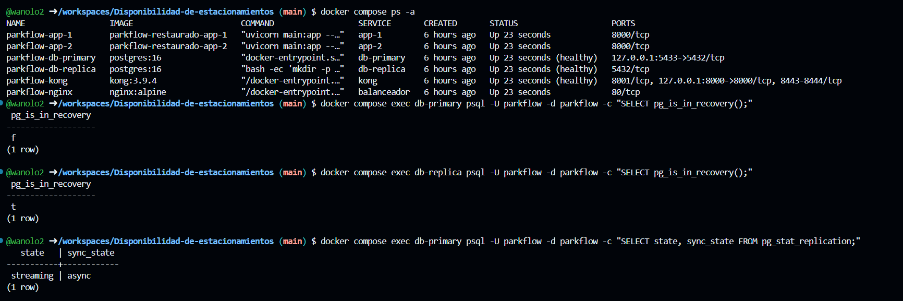

Se observa el funcionamiento de los seis contenedores y la configuración de replicación asíncrona.

### 3.2. Escritura de control antes de la caída

Se registró la entrada del vehículo **RPO620** en el espacio 6 mediante una solicitud POST hacia PostgreSQL primaria.

**Comando utilizado:**

```bash
curl -i -X POST http://localhost:8000/api/v1/movimientos \
  -H "Content-Type: application/json" \
  -d '{"espacio_id":6,"tipo":"entrada","patente":"RPO620"}'
```

**Resultados:**

- HTTP 201 Created.
- X-DB: primary.
- X-Instance: app-1.
- Patente registrada: RPO620.
- ID del movimiento: 67.

Posteriormente, se consultó PostgreSQL réplica y se confirmó que el movimiento ID 67 estaba almacenado correctamente.

**Captura 2 — Escritura replicada**

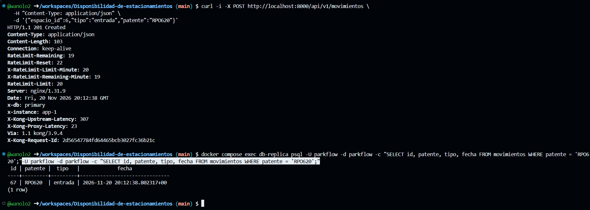

Se muestra la escritura exitosa en la primaria y la presencia del registro en la réplica antes de provocar la falla.

### 3.3. Caída de PostgreSQL primaria

Se registró la hora de inicio del experimento y se detuvo la base de datos primaria.

**Comando utilizado:**

```bash
date +%s | tee "$HOME/parkflow-prueba3-inicio.txt"
docker compose stop db-primary
```

Se verificó el estado de los contenedores mediante `docker compose ps -a`.

**Resultados:**

- db-primary: detenida.
- db-replica: funcionando.
- FastAPI, NGINX y Kong: activos.

**Captura 3 — PostgreSQL primaria detenida**

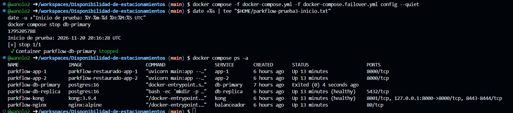

Se evidencia la caída controlada del servidor principal, mientras los demás componentes permanecen activos.

### 3.4. Fallo de las operaciones de escritura

Con PostgreSQL primaria detenida, se intentó registrar el vehículo **FAIL620** en el espacio 7.

**Comando utilizado:**

```bash
curl -i --max-time 10 -X POST http://localhost:8000/api/v1/movimientos \
  -H "Content-Type: application/json" \
  -d '{"espacio_id":7,"tipo":"entrada","patente":"FAIL620"}'
```

**Resultado: HTTP 500 Internal Server Error.**

La solicitud falló porque las instancias FastAPI continuaban intentando conectarse a PostgreSQL primaria, que se encontraba fuera de servicio.

**Captura 4 — Fallo de escritura**

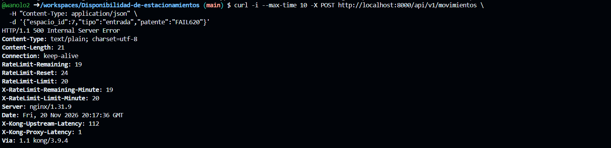

Se observa el error HTTP 500 al intentar registrar un movimiento durante la caída de la primaria.

### 3.5. Promoción de PostgreSQL réplica

Después de comprobar que la antigua primaria permanecía detenida, se promovió la réplica para convertirla en la nueva primaria.

**Comando utilizado:**

```sql
SELECT pg_promote(wait => true, wait_seconds => 30);
```

**Resultado:** `t` (true).

Posteriormente, se verificó el nuevo rol mediante:

```sql
SELECT pg_is_in_recovery();
```

**Resultado:** `f` (false).

Ambos resultados confirmaron que la réplica fue promovida correctamente y dejó de funcionar en modo recuperación.

**Captura 5 — Réplica promovida a primaria**

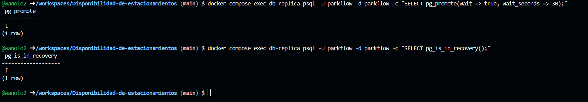

Se muestran los resultados de `pg_promote()` y `pg_is_in_recovery()`, confirmando la promoción de PostgreSQL.

### 3.6. Redirección de FastAPI y NGINX

Se utilizó el archivo `docker-compose.failover.yml` para modificar la variable `DB_PRIMARY_URL` de ambas instancias FastAPI, apuntándolas hacia `db-replica`, que ahora funcionaba como primaria.

Se recrearon las instancias mediante:

```bash
docker compose -f docker-compose.yml -f docker-compose.failover.yml up -d --no-deps --force-recreate app-1 app-2
```

Se utilizó `--no-deps` para evitar que Docker Compose iniciara nuevamente la antigua primaria.

Posteriormente, se validó y recargó NGINX:

```bash
docker compose exec balanceador nginx -t
docker compose exec balanceador nginx -s reload
```

**Resultados:**

- app-1: iniciada.
- app-2: iniciada.
- Configuración de NGINX: válida.
- Recarga de NGINX: ejecutada correctamente.

**Captura 5B — Redirección de servicios**

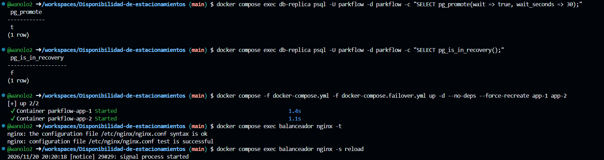

Se evidencia la recreación de ambas instancias FastAPI y la recarga del balanceador.

### 3.7. Recuperación de las operaciones de escritura

Antes de repetir la escritura, se comprobó que el espacio 7 estaba libre y que no existía previamente el movimiento FAIL620.

Posteriormente, se realizó nuevamente la solicitud POST.

**Comando utilizado:**

```bash
curl -i --max-time 15 -X POST http://localhost:8000/api/v1/movimientos \
  -H "Content-Type: application/json" \
  -d '{"espacio_id":7,"tipo":"entrada","patente":"FAIL620"}'
```

**Resultados:**

| Comprobación | Resultado |
|---|---|
| Respuesta HTTP | 201 Created |
| X-DB | primary |
| X-Instance | app-1 |
| Vehículo | FAIL620 |
| Espacio | 7 |
| Movimiento registrado | ID 100 |

La respuesta confirmó que ParkFlow recuperó la capacidad de realizar escrituras en la nueva primaria.

**Captura 6 — Escritura recuperada**

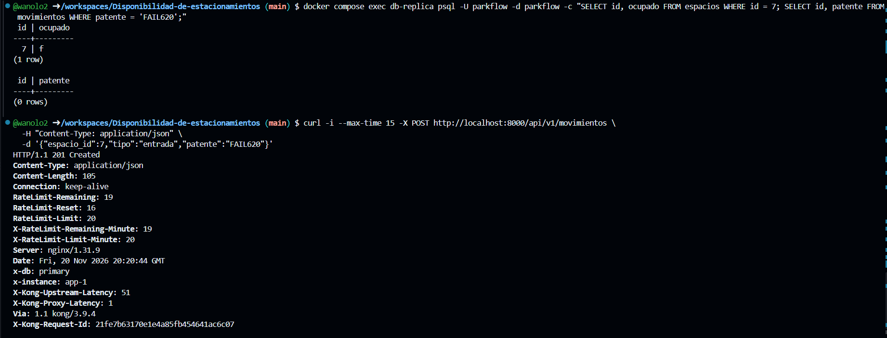

Se observa HTTP 201 Created después de promover la réplica y restablecer las conexiones.

### 3.8. Medición del RTO

El **RTO (Recovery Time Objective)** corresponde al tiempo objetivo de recuperación del servicio después de una falla.

Para realizar la medición, se guardó la hora de inicio antes de detener PostgreSQL primaria y la hora final después de recuperar exitosamente las escrituras.

**Comando utilizado:**

```bash
date +%s > "$HOME/parkflow-prueba3-fin.txt"

echo "Tiempo de recuperación: $(($(cat "$HOME/parkflow-prueba3-fin.txt") - $(cat "$HOME/parkflow-prueba3-inicio.txt"))) segundos"
```

**Resultado obtenido: 266 segundos (4 minutos y 26 segundos).**

| Indicador | Resultado |
|---|---|
| RTO objetivo | 300 segundos |
| Recuperación manual observada | 266 segundos |
| Diferencia | 34 segundos menos |
| Cumplimiento en este ensayo | Sí |

El tiempo registrado incluye el procedimiento manual de detención, promoción de la réplica, reconfiguración de FastAPI y comprobación de la escritura recuperada.

**Conclusión del RTO:** En este ensayo se obtuvo un intervalo de recuperación manual inferior al objetivo establecido de cinco minutos. Sin embargo, el resultado no garantiza que futuras recuperaciones tengan el mismo tiempo.

**Captura 7 — Medición del RTO**

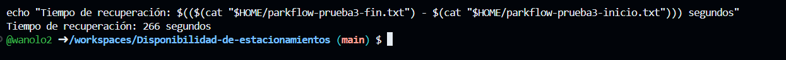

Se observa el tiempo de recuperación registrado de **266 segundos**.

### 3.9. Verificación del RPO

El **RPO (Recovery Point Objective)** representa el máximo período de pérdida de datos aceptable ante una falla.

Para evaluar la conservación de información, se verificaron los registros realizados antes y después de la promoción.

**Consulta utilizada:**

```sql
SELECT id, patente, tipo, fecha
FROM movimientos
WHERE patente IN ('RPO620', 'FAIL620')
ORDER BY id;
```

**Resultados:**

| ID | Patente | Tipo | Momento |
|---|---|---|---|
| 67 | RPO620 | entrada | Antes de la caída |
| 100 | FAIL620 | entrada | Después de la recuperación |

Se confirmó que el movimiento **RPO620**, registrado antes de la caída, permaneció disponible después de promover la réplica.

También se verificó el almacenamiento del movimiento **FAIL620**, registrado después de recuperar el servicio.

**Resultado observado: 0 registros de control perdidos.**

No obstante, debido a que la replicación es asíncrona, podrían perderse transacciones confirmadas que todavía no hayan llegado a la réplica al momento de una falla.

La prueba permitió comprobar la conservación de la escritura de control, pero no medir el RPO temporal exacto ni verificar el cumplimiento del objetivo de 30 segundos.

**Captura 8 — Verificación del RPO**

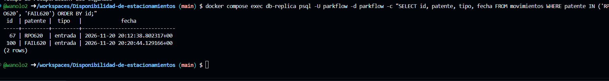

Se observa la presencia de ambos registros después del failover, confirmando que la escritura de control fue conservada.

### 3.10. Restauración de la arquitectura original

Una vez finalizado el experimento, se realizó un respaldo de PostgreSQL desde la base promovida mediante `pg_dump`.

Posteriormente, se detuvieron los servicios, se crearon nuevos volúmenes y se inicializó nuevamente PostgreSQL primaria.

Se restauraron los datos utilizando `pg_restore` y se levantó una nueva réplica.

Finalmente, se inició ParkFlow utilizando la configuración original de Docker Compose.

**Resultados verificados:**

- PostgreSQL primaria: funcionando.
- PostgreSQL réplica: funcionando en modo recuperación.
- Espacios registrados: 200.
- Movimientos restaurados: 4.
- Consulta de disponibilidad: HTTP 200 OK.
- Lecturas desde `X-DB: replica`.
- FastAPI configurado para escribir en `db-primary`.

La arquitectura recuperó su configuración original, separando nuevamente las operaciones de escritura y lectura.

### Conclusión de la Prueba 3

Se comprobó que ParkFlow puede recuperar manualmente las operaciones de escritura después de una caída de PostgreSQL primaria mediante la promoción de su réplica.

**El tiempo de recuperación manual observado fue de 266 segundos (4 minutos y 26 segundos)**, inferior al objetivo de 300 segundos.

Se verificó que la escritura de control anterior a la falla permaneció disponible después de la promoción, sin pérdidas observadas en ese registro.

Sin embargo, la replicación asíncrona mantiene el riesgo de pérdida de datos no replicados y el RPO temporal exacto no fue determinado.

Como mejoras futuras se propone automatizar la detección de fallos, la promoción de PostgreSQL y la redirección de conexiones para disminuir la intervención manual.


---

## Anexo — Evidencias de las Pruebas 1 y 2

### Prueba 1

**falla1 app2 detenida**

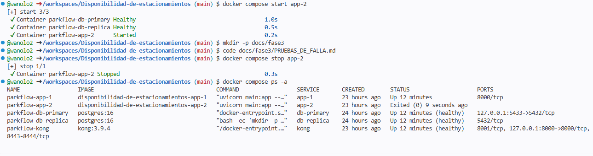

**falla1 disponibilidad app1**

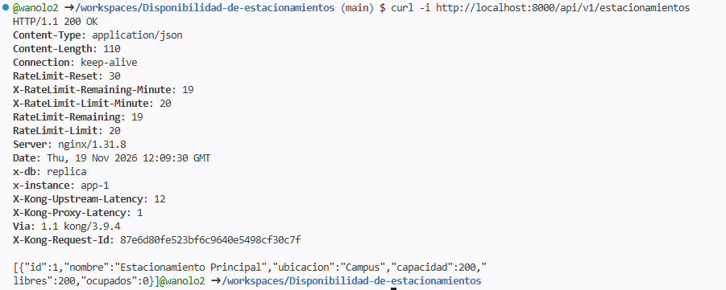


### Prueba 2

**falla2 DBReplica Pausada**

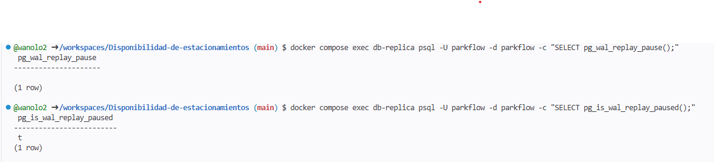

**falla2 DBreplica recuperada**

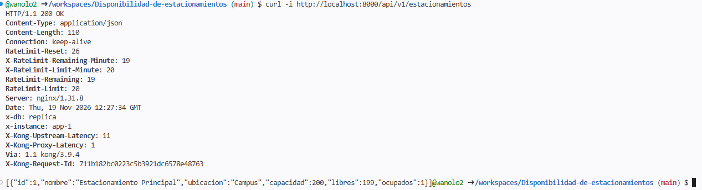

**falla2 conexión recuperada**

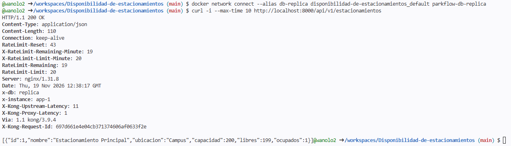

**falla2 escritura DBprimaria**

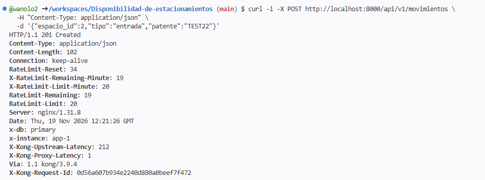

**falla2 lectura desactualizada**

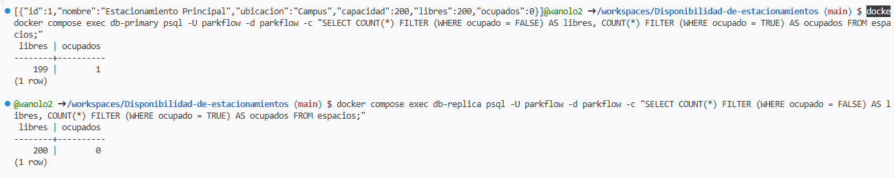

**falla2 replica desconectada**

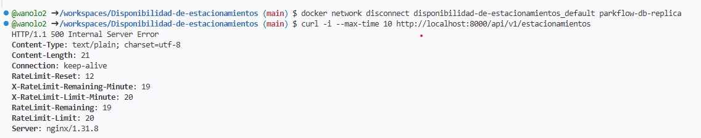
